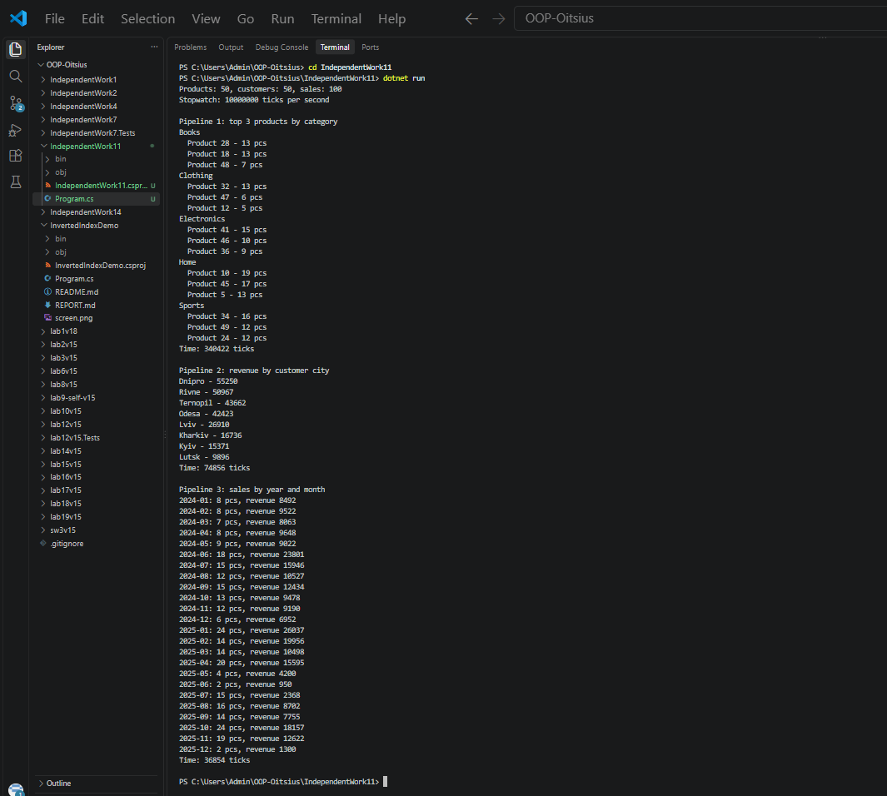

# Самостійна робота №17: LINQ pipelines: ETL та аналітика

Консольний проєкт IndependentWork11 для сценарію "Продажі". Є класи Product, Customer і Sale, 50 товарів, 50 клієнтів і 100 продажів. Дані генеруються через Random із seed 42, тому результат однаковий при кожному запуску.

## Що реалізовано

1. TopProductsByCategory: топ-3 товари за кількістю продажів у кожній категорії.
2. RevenueByCity: загальний дохід за містами клієнтів, від більшого до меншого.
3. SalesByMonth: кількість проданих одиниць і дохід за роками та місяцями.

Для кожного пайплайну вимірюється час через Stopwatch. Опис, вимірювання і висновки в [REPORT.md](REPORT.md).

## Запуск

Перейти в папку проєкту командою cd IndependentWork11 і виконати dotnet run.

## Приклад виводу

