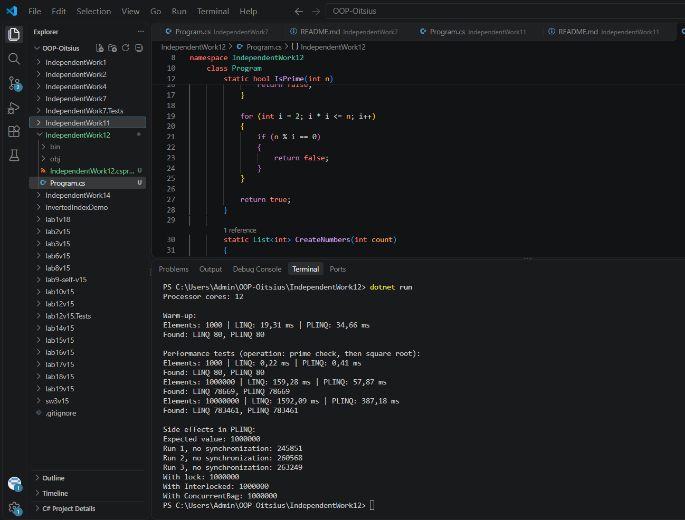

# Самостійна робота №18: PLINQ: дослідження продуктивності та безпеки

Консольний проєкт IndependentWork12. Порівнюється звичайний LINQ і PLINQ (AsParallel) на великих колекціях і показано проблему побічних ефектів при паралельній обробці.

## Що реалізовано

1. Колекція List<int> із випадкових чисел (Random із seed 42) розміром 1000, 1 000 000 і 10 000 000 елементів.
2. Важка операція: перевірка числа на простоту (IsPrime), потім квадратний корінь (Where і Select).
3. Вимірювання часу LINQ і PLINQ через Stopwatch та перевірка, що кількість знайдених чисел збігається.
4. Демонстрація побічного ефекту: спільний лічильник у ForAll без синхронізації дає неправильний результат. Виправлення через lock, Interlocked і ConcurrentBag.

Опис, вимірювання і висновки в [REPORT.md](REPORT.md).

## Запуск

Перейти в папку проєкту командою cd IndependentWork12 і виконати dotnet run.

## Приклад виводу

