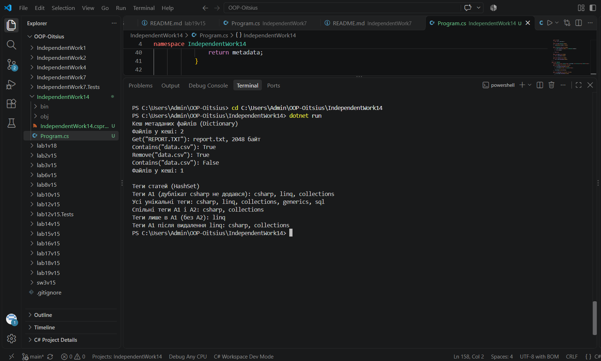

# Самостійна робота №14

**Тема:** Вивчення `Dictionary<TKey, TValue>` та `HashSet<T>` у бібліотеках .NET.

## Що реалізовано

- Сценарій 1: `FileMetadataCache` на базі `Dictionary<string, FileMetadata>` (методи `Add`, `Get`, `Remove`, `Contains`, ключі без урахування регістру).
- Сценарій 2: `TagManager` на базі `Dictionary<string, HashSet<string>>` (методи `AddTag`, `RemoveTag`, `GetAllUniqueTags`, `FindCommonTags`, `FindTagsOnlyIn`; використано `UnionWith`, `IntersectWith`, `ExceptWith`).
- Необов'язковий сценарій 3 (пошуковий індекс) не реалізовано.

Звіт з аналізом прикладів з відкритого коду і порівняльною таблицею: [REPORT.md](REPORT.md).

## Запуск

cd IndependentWork14

dotnet run

## Результат виконання

## Контрольні питання

**1. Які переваги generic-колекцій над неузагальненими структурами даних у .NET?**
Безпека типів під час компіляції, відсутність приведення типів, кращі продуктивність (немає упаковки й розпаковки) і повторне використання одного коду для різних типів.

**2. У яких сценаріях доцільніше використовувати `Dictionary<TKey, TValue>`, а в яких `HashSet<T>`?**
`Dictionary` потрібен, коли за ключем треба швидко знаходити значення (кеш, відповідність "тип до типу"). `HashSet` потрібен, коли важлива унікальність елементів і швидка перевірка наявності, а також операції над множинами.

**3. Як `IEqualityComparer<T>` впливає на коректність і продуктивність `Dictionary` та `HashSet`?**
Comparer визначає, що вважається однаковим ключем (наприклад, `report.txt` і `REPORT.TXT`) і як обчислюється хеш. Від цього залежить коректність. Якщо `GetHashCode` розподіляє значення погано, виникає багато колізій і колекція працює повільніше. `Equals` і `GetHashCode` мають бути узгоджені.

**4. Чому інвертований індекс зручно будувати саме на базі `Dictionary<string, HashSet<int>>`?**
Словник швидко знаходить за словом множину документів, а `HashSet` не дублює id документів і дає готові операції `IntersectWith` (AND) та `UnionWith` (OR).