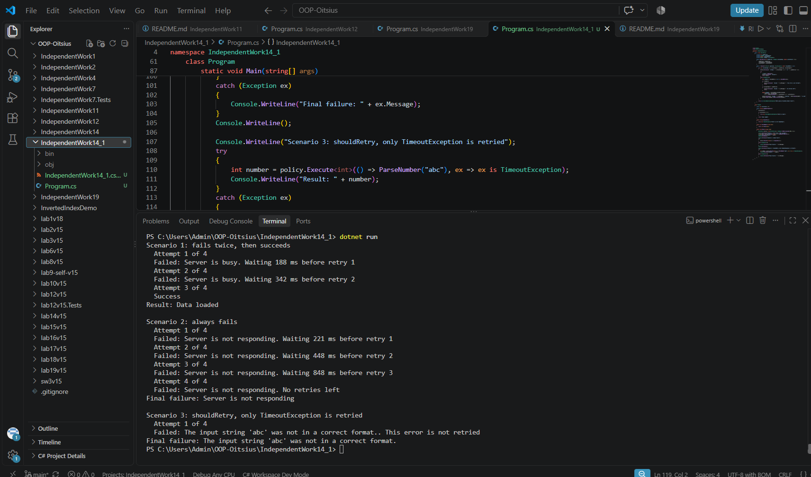

# Самостійна робота №20: Реалізація exponential backoff

Консольний проєкт з власним класом RetryPolicy для повторних спроб з експоненційною затримкою та jitter. За методичкою проєкт мав називатися IndependentWork14, але така папка вже існує в репозиторії і належить самостійній №14 (Dictionary і HashSet). Щоб не перезаписати ту роботу, цей проєкт названо IndependentWork14_1.

## Що реалізовано

Клас RetryPolicy має приватні поля _maxRetries, _initialDelay, _jitterFactor і конструктор RetryPolicy(maxRetries, initialDelay, jitterFactor = 0.2). Метод Execute<T> приймає будь-яку операцію Func<T> і необов'язковий делегат shouldRetry. Перед кожним повтором рахується затримка за формулою: initialDelay * 2^retryAttempt * (1 + random * jitterFactor * 2 - jitterFactor). Кожна спроба, причина невдачі та затримка виводяться в консоль. Після вичерпання спроб викидається останній виняток.

У Main показано три сценарії: успіх після двох невдач, остаточна невдача після всіх спроб і сценарій із shouldRetry, де помилка формату не повторюється.

## Запуск

Перейти в папку проєкту командою cd IndependentWork14_1 і виконати dotnet run.

## Приклад виводу

Опис виводу. У сценарії 1 перші дві спроби завершуються помилкою Server is busy, перед повторами програма чекає 188 мс і 342 мс (це приблизно 200 мс і 400 мс із випадковим відхиленням до ±20%), а третя спроба успішна. У сценарії 2 операція завжди завершується помилкою, затримки між чотирма спробами 221, 448 і 848 мс (приблизно 200, 400 і 800 мс), тобто подвоюються, а після останньої спроби виняток передається в Main. У сценарії 3 помилка формату не належить до TimeoutException, тому shouldRetry повертає false і повтору немає.

## Висновок щодо меж застосування Retry з exponential backoff

Retry з експоненційною затримкою доречний для тимчасових збоїв: короткої недоступності сервісу, перевантаження, обриву мережі. Перші повтори швидкі, далі затримка росте, і сервіс має час відновитися, а jitter не дає багатьом клієнтам повторювати запити одночасно. Retry не варто застосовувати до постійних помилок (неправильні дані, відсутній ресурс, помилка автентифікації), бо повтор нічого не змінить, і до неідемпотентних операцій (оплата, створення замовлення), бо вони можуть виконатися кілька разів. Також потрібно обмежувати кількість спроб і загальний час очікування, а при тривалому збої краще використовувати Circuit Breaker. Саме для цього в політиці є делегат shouldRetry, який вибирає, які помилки повторювати.

## Відповіді на контрольні питання

1. Чому експоненційна затримка зазвичай ефективніша за фіксовану для тимчасових збоїв?

Короткі збої проходять після швидкого першого повтору, а якщо збій довший, затримки зростають, і сервіс не отримує постійний потік запитів. Фіксована затримка або надто мала і навантажує сервіс, або надто велика і даремно змушує чекати.

2. Для чого потрібен jitter і як він зменшує ризик одночасних повторних спроб?

Jitter додає до затримки випадкову складову (наприклад, ±20%). Тоді клієнти, у яких збій стався одночасно, повторюють запити в різний час, і сервіс не отримує хвилю запитів в один момент.

3. Яку роль відіграє делегат shouldRetry у власній реалізації політики повторних спроб?

Він отримує виняток і повертає true або false, тобто вирішує, чи варто повторювати спробу. Тимчасові помилки (наприклад, TimeoutException) повторюються, а постійні (наприклад, помилка формату) одразу викидаються без марних повторів.

4. У яких випадках повторна спроба не є безпечною та її слід заборонити?

Для неідемпотентних операцій, де повтор може створити дубль (оплата, створення замовлення, надсилання повідомлення). Також не слід повторювати при постійних помилках (неправильні дані, відсутній ресурс, невірний пароль), коли повтор безглуздий.