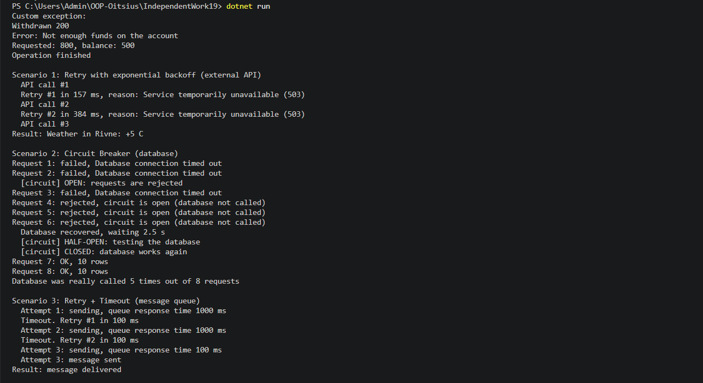

# Самостійна робота №19: Дизайн винятків і політики retry (Polly)

Консольний проєкт IndependentWork19. Містить власний тип винятку та три сценарії відмовостійкості на бібліотеці Polly.

## Що реалізовано

1. Власний виняток InsufficientFundsException із властивостями RequestedAmount і CurrentBalance та чотирма конструкторами, демонстрація через try-catch-finally.
2. Сценарій 1: Retry з експоненційною затримкою та jitter (виклик зовнішнього API).
3. Сценарій 2: Circuit Breaker (база даних із тривалим збоєм).
4. Сценарій 3: Retry разом із Timeout (перевантажена черга повідомлень).

Кожна спроба і зміна стану логуються в консоль. Опис, обґрунтування стратегій і висновки в [REPORT.md](REPORT.md).

## Запуск

Перейти в папку проєкту командою cd IndependentWork19. Пакет Polly підключається командою dotnet add package Polly (вона вже виконана, пакет записаний у IndependentWork19.csproj). Запустити командою dotnet run.

## Приклад виводу

