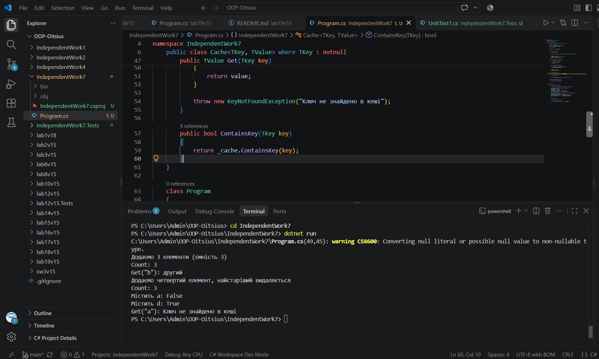
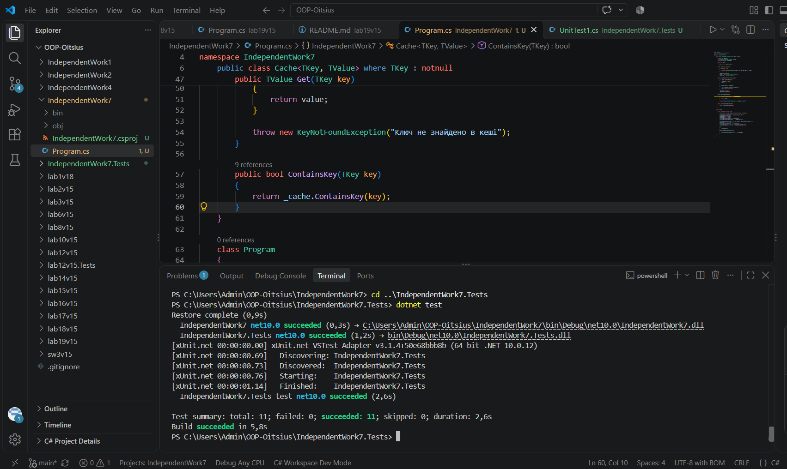

# Самостійна робота №13

**Тема:** Узагальнений кеш `Cache<TKey, TValue>` із тестами.

## Мета

Розробити узагальнений клас кешу, який зберігає дані за ключем та має політику видалення
найстаріших елементів (FIFO - First In, First Out), а також написати юніт-тести для перевірки його
функціональності. Додатково можна реалізувати LRU як розширення базового рішення.

## Структура

- **IndependentWork7**: основний проєкт із класом `Cache<TKey, TValue>`.
- **IndependentWork7.Tests**: проєкт з тестами xUnit, що посилається на основний.

## Що реалізовано

- Приватні поля `_capacity`, `_cache` (`Dictionary<TKey, TValue>`), `_keysOrder` (`Queue<TKey>`).
- Конструктор `Cache(int capacity)`, для ємності не більше 0 кидає `ArgumentException`.
- `Add`: якщо кеш повний, видаляє найстаріший елемент (FIFO). Якщо ключ уже є, оновлює значення без видалення інших.
- `Get`: повертає значення через `TryGetValue`, а для відсутнього ключа кидає `KeyNotFoundException`.
- `ContainsKey` і властивість `Count`.

## Запуск

cd IndependentWork7

dotnet run

## Результат виконання

**Примітка про виправлену помилку.** На скріншоті виводу видно попередження компілятора `CS8600` (рядок з `TryGetValue` у методі `Get`). Воно з'явилося, бо компілятор не був упевнений, що для довільного типу `TValue` змінна `value` не буде `null`. У коді це виправлено: замість `out TValue value` тепер `out TValue? value`. Логіка класу від цього не змінилася, а після виправлення попередження зникло.

## Тести

Написано 11 тестів: додавання, отримання за ключем, видалення найстаршого при переповненні, збереження найновіших елементів, `KeyNotFoundException` для відсутнього ключа, `ContainsKey` (є і немає), `Count` (порожній кеш і не більше ємності), оновлення існуючого ключа, некоректна ємність. Усі 11 тестів проходять.

cd IndependentWork7.Tests

dotnet test

## Контрольні питання

**1. Які переваги надає `Cache<TKey, TValue>` порівняно з окремими неузагальненими реалізаціями кешу?**
Один клас працює з будь-якими типами ключів і значень, типи перевіряються під час компіляції, не потрібні приведення типів і немає упаковки та розпаковки.

**2. Чому для реалізації політики FIFO зручно поєднувати `Dictionary<TKey, TValue>` з `Queue<TKey>`?**
`Dictionary` швидко знаходить значення за ключем, але не зберігає порядок додавання. `Queue` зберігає порядок: `Dequeue()` повертає найстаріший ключ, який потім видаляється зі словника.

**3. У яких випадках метод `Get` повинен викидати `KeyNotFoundException`, а коли доцільніше використовувати підхід на кшталт `TryGetValue`?**
Виняток доречний, коли відсутність ключа це помилка (елемент мав бути в кеші). `TryGetValue` зручніший, коли відсутність ключа це звичайна ситуація (промах кешу): тоді виняток не потрібен, достатньо перевірки `if`.

**4. Які тести є критично важливими для перевірки політики витіснення елементів з кешу?**
Що при переповненні видаляється саме найстаріший елемент, а новіші лишаються. Що `Count` не перевищує ємність. Що оновлення існуючого ключа нічого не витісняє. Що відсутній ключ кидає виняток.