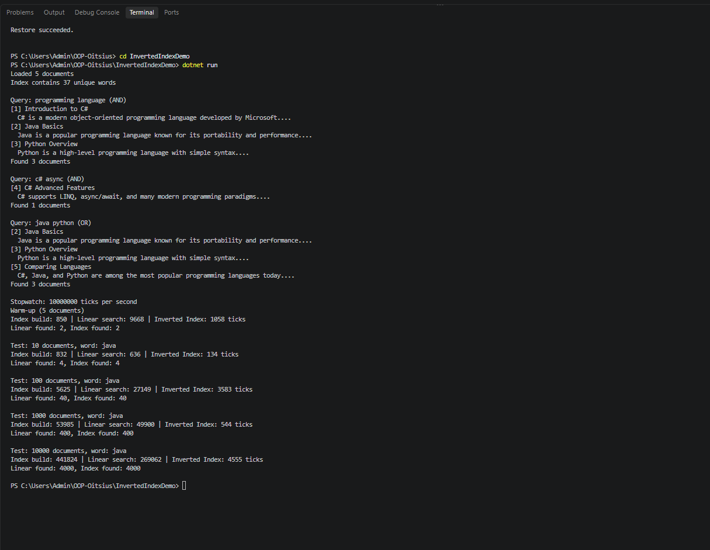

# Самостійна робота №16

**Тема:** Колекції в практиці ООП: інвертований індекс і вимірювання продуктивності.

## Що реалізовано

- `Document`, `TextProcessor` (`Tokenize`, `NormalizeWord`, `RemoveStopWords`), `InvertedIndex` на `Dictionary<string, HashSet<int>>` з методами `SearchSingleWord`, `SearchMultipleWords` (AND через `IntersectWith`) і `SearchAnyWord` (OR через `UnionWith`).
- `PerformanceTest.CompareSearchMethods` порівнює лінійний пошук та пошук через індекс (однакова нормалізація тексту) і виводить час у тиках `Stopwatch`.
- Вимірювання для 10, 100, 1000 і 10000 документів.

Опис реалізації, таблиця вимірювань і висновки: [REPORT.md](REPORT.md).

## Запуск

cd InvertedIndexDemo

dotnet run

## Приклад виводу

