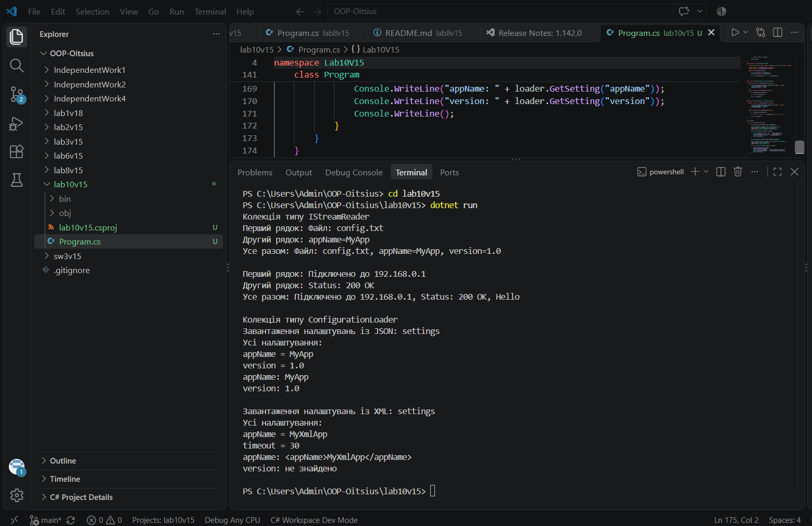

# Лабораторна робота №6

**Тема:** Абстрактні класи та інтерфейси. Контракти та реалізації.

**Варіант:** 15. IStreamReader та ConfigurationLoader

## Мета

Навчитися створювати та використовувати абстрактні класи та інтерфейси для визначення
контрактів та реалізації спільної логіки, а також розуміти критерії вибору між ними.

## Що реалізовано

- **Інтерфейс IStreamReader**: методи ReadLine() і ReadAll()
- **FileStreamReader** і **NetworkStreamReader**: два класи, які по-різному реалізують інтерфейс (імітують читання з файлу і з мережі)
- **Абстрактний клас ConfigurationLoader**: абстрактні методи LoadSettings() і GetSetting(), конкретний метод DisplayAllSettings()
- **JsonConfigLoader** і **XmlConfigLoader**: похідні класи, які реалізують абстрактні методи через override і використовують конкретний метод базового класу
- У Main створено колекції `List<IStreamReader>` і `List<ConfigurationLoader>`, у циклах викликаються їхні методи

## Запуск

cd lab10v15
dotnet run

## Результат виконання

## Контрольні питання

**1. У чому полягає основна відмінність між абстрактним класом та інтерфейсом?**
Абстрактний клас не можна створити через new, він може мати поля, конструктори і звичайні методи з реалізацією, а також абстрактні методи. Інтерфейс це лише контракт без реалізації. Абстрактний клас описує зв'язок "є різновидом", а інтерфейс "може робити".

**2. Коли доцільно використовувати абстрактний клас, а коли — інтерфейс? Наведіть приклади.**
Абстрактний клас доречний, коли класи тісно пов'язані й мають спільну базову поведінку. У нашій роботі ConfigurationLoader має спільний метод DisplayAllSettings(), а завантаження налаштувань кожен нащадок реалізує по-своєму. Інтерфейс доречний, коли різні класи без спільного базового класу повинні виконувати один контракт. У нашій роботі IStreamReader реалізують і читання з файлу, і читання з мережі.

**3. Чи може клас успадковувати від кількох абстрактних класів? А реалізовувати кілька інтерфейсів?**
Ні, клас може успадковувати лише від одного абстрактного класу. Але він може реалізовувати багато інтерфейсів.

**4. Як абстрактні класи та інтерфейси сприяють поліморфізму та гнучкості архітектури?**
Через колекцію типу інтерфейсу або абстрактного класу можна працювати з різними об'єктами однаково, а метод вибирається за реальним типом об'єкта. Нові класи можна додавати, не змінюючи код, який з ними працює. Інтерфейси також дають слабку зв'язаність компонентів.