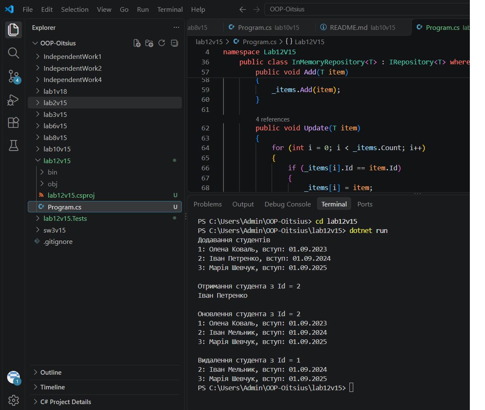
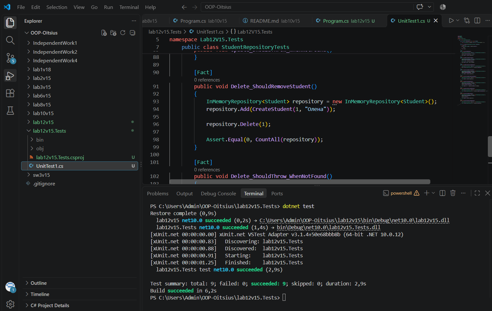

# Лабораторна робота №7

**Тема:** Узагальнені типи (Generics). IRepository з where-обмеженнями та тестами.

**Варіант:** 15. Сутність Student: FirstName (string), LastName (string), EnrollmentDate (DateTime)

## Мета

Навчитися створювати узагальнені інтерфейси та класи, застосовувати where-обмеження для типів-параметрів, а також розробляти юніт-тести для перевірки коректності узагальнених реалізацій.

## Структура проєктів

- **lab12v15**: основний проєкт
- **lab12v15.Tests**: проєкт з юніт-тестами (xUnit), що посилається на основний

## Що реалізовано

- **IEntity**: інтерфейс з властивістю `int Id { get; set; }`
- **Student**: сутність за варіантом, реалізує IEntity, має властивості FirstName, LastName, EnrollmentDate
- **IRepository<T>**: узагальнений інтерфейс з обмеженням `where T : IEntity` і методами GetById, GetAll, Add, Update, Delete
- **InMemoryRepository<T>**: реалізація IRepository<T>, яка зберігає дані в `List<T>`; для неіснуючого Id кидає ArgumentException
- У Main показано додавання, отримання, оновлення і видалення студентів

## Запуск

cd lab12v15
dotnet run

## Результат виконання

## Тести

Написано 9 тестів: для Add, GetById, GetAll, Update, Delete, включно з перевіркою неіснуючого Id.

cd lab12v15.Tests
dotnet test

## Контрольні питання

**1. Яка роль where-обмежень у Generics? Наведіть приклади їх використання.**
where-обмеження задають, які типи можна підставляти замість T. Наприклад, `where T : class` (тип має бути посилальним), `where T : new()` (тип має мати конструктор без параметрів), `where T : IInterface` (тип має реалізовувати інтерфейс). У нашій роботі `where T : IEntity` гарантує, що в будь-якого T є Id, тому репозиторій може його використовувати.

**2. Навіщо потрібен шаблон IRepository? Які переваги він дає?**
IRepository описує набір операцій для роботи з даними (отримати, додати, оновити, видалити) і ховає, як саме дані зберігаються. Код, який використовує репозиторій, не залежить від конкретної реалізації, тому її можна замінити, наприклад пам'ять на файл, не змінюючи решту коду. Узагальнений IRepository<T> підходить для будь-якої сутності.

**3. Поясніть, чому юніт-тести є важливими при розробці узагальнених компонентів.**
Узагальнений код працює з багатьма типами, і тести перевіряють, що він працює правильно для конкретної сутності. Тести швидко знаходять помилки після змін у коді і перевіряють крайні випадки, наприклад неіснуючий Id.

**4. Які проблеми вирішують Generics порівняно з використанням object?**
З object компілятор не перевіряє типи, і помилка (InvalidCastException) виникає лише під час виконання. Для типів-значень відбувається упаковка і розпаковка, що забирає пам'ять і час. Generics дають безпеку типів на етапі компіляції, кращу продуктивність і не потребують ручного приведення типів.