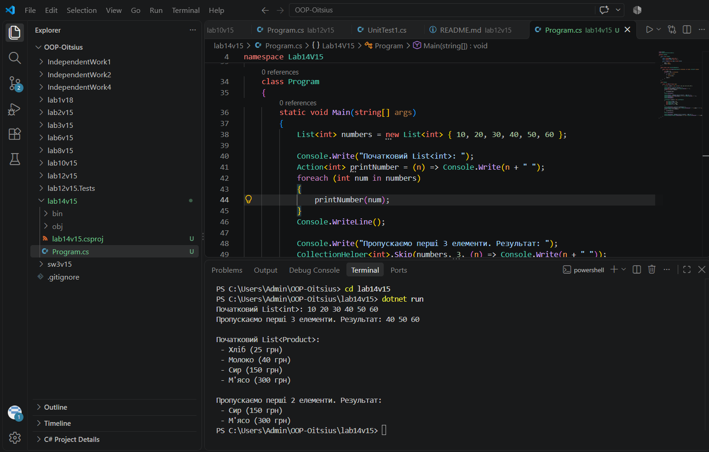

# Лабораторна робота №8

**Тема:** Делегати й лямбда-вирази у практиці колекцій: `CollectionHelper<T>`.

**Варіант:** 15. Метод `Skip`: пропускає перші `count` елементів і повертає решту.

## Мета

Навчитися передавати поведінку як параметр через делегати Func, Action, Predicate, будувати на цій основі універсальні операції над колекціями та використовувати лямбда-вирази у практиці ООП.

## Що реалізовано

- **Product**: власний клас (Name, Price) для демонстрації роботи узагальненого методу на нетривіальному типі.
- **CollectionHelper&lt;T&gt;**: статичний узагальнений клас-утиліта.
- **Метод Skip (варіант 15)**: `public static IEnumerable<T> Skip(IEnumerable<T> collection, int count)`. Пропускає перші `count` елементів і повертає решту. Власна логіка реалізована через цикл `foreach` та лічильник, без використання однойменного LINQ-оператора.
- **Демонстрація в Main**: для `List<int>` (пропуск перших 3 елементів), `List<string>` (пропуск перших 2), `List<Product>` (пропуск перших 2) і граничний випадок, коли пропускається більше елементів, ніж є в списку. Результати виводяться через лямбда-вирази, збережені в змінних `Action`.

## Запуск

cd lab14v15
dotnet run

## Результат виконання

## Контрольні питання

**1. Що таке делегат і для чого він використовується?**
Делегат — це тип, який представляє посилання на метод із певним списком параметрів та типом повернення. По суті, це безпечний до типів покажчик на функцію. Він використовується, щоб передавати методи як параметри, зберігати їх у змінних і викликати їх динамічно.

**2. У чому полягає різниця між Func та Action?**
`Action<T>` представляє метод, який приймає параметри, але не повертає значення (void). `Func<T, TResult>` представляє метод, який приймає параметри і повертає значення типу TResult, останній тип-параметр завжди є типом повернення. У нашій роботі ми використовували `Action`, бо нам не потрібно було нічого повертати, а лише виводити елементи в консоль.

**3. Як лямбда-вирази спрощують роботу з делегатами?**
Лямбда-вирази дозволяють записати анонімну функцію коротко, наприклад `n => n * n`, не створюючи окремий іменований метод. Це робить код лаконічнішим і читабельнішим. У нашій роботі лямбди збережені в змінних Action і використовуються для виводу елементів.

**4. Які переваги дають узагальнені методи при роботі з колекціями?**
Узагальнені методи дають безпеку типів на етапі компіляції (не потрібно приводити типи вручну), кращу продуктивність (немає упаковки і розпаковки) і дозволяють написати код один раз для будь-якого типу даних. Наш `CollectionHelper<T>` працює і з `int`, і з `string`, і з `Product`.