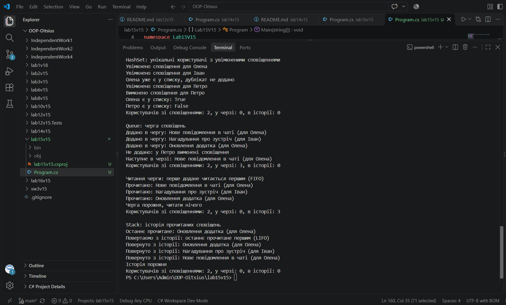

# Лабораторна робота №9

**Тема:** `HashSet`, `Queue`, `Stack`: практичні сценарії.

**Варіант:** 15. Обробка сповіщень

## Мета

Навчитися використовувати спеціалізовані колекції `HashSet<T>`, `Queue<T>`, `Stack<T>` для розв'язання практичних задач, зрозуміти їхні особливості та сценарії застосування.

## Що реалізовано

- **`HashSet<string>`**: унікальні користувачі з увімкненими сповіщеннями. Додавання (`Add`), видалення (`Remove`), перевірка наявності (`Contains`), дублікат не додається.
- **`Queue<Notification>`**: черга сповіщень. Додавання в кінець (`Enqueue`), перегляд першого (`Peek`), видалення з початку (`Dequeue`). Сповіщення читаються в порядку додавання (FIFO).
- **`Stack<Notification>`**: історія прочитаних сповіщень. Додавання на вершину (`Push`), перегляд вершини (`Peek`), видалення з вершини (`Pop`). З історії першим повертається останнє прочитане (LIFO).
- **`Notification`**: клас даних (користувач і текст сповіщення).
- **`NotificationSystem`**: клас, який об'єднує три колекції. Сповіщення потрапляє в чергу, лише якщо користувач є в `HashSet`.

## Запуск

cd lab15v15

dotnet run

## Результат виконання

## Контрольні питання

**1. У чому різниця між `List<T>` та `HashSet<T>`?**
`List<T>` зберігає елементи по порядку і допускає дублікати. `HashSet<T>` це неупорядкована колекція унікальних елементів: однакове значення двічі не додається. Також `HashSet<T>` швидко перевіряє, чи є елемент у колекції.

**2. Коли доцільно використовувати `Queue<T>` замість `List<T>`?**
Коли потрібен порядок FIFO: елементи обробляються в тому порядку, в якому були додані. Наприклад, черга завдань, подій або сповіщень. У нашій роботі сповіщення читаються в порядку додавання.

**3. Наведіть приклад реальної задачі, де потрібен `Stack<T>`.**
Відміна операцій (Undo): остання виконана дія скасовується першою. Також історія навігації (кнопка "Назад") та обхід дерев (DFS). У нашій роботі `Stack<T>` зберігає історію прочитаних сповіщень, і останнє прочитане повертається першим.

**4. Яка складність операції `Contains()` для `HashSet<T>` і чому?**
O(1) в середньому. `HashSet<T>` визначає місце елемента за його хешем, тому йому не потрібно перебирати всі елементи, як у списку.

**5. Чому `Queue<T>` називають FIFO, а `Stack<T>` — LIFO?**
`Queue<T>`: First In, First Out, перший доданий елемент виходить першим (додаємо в кінець, забираємо з початку). `Stack<T>`: Last In, First Out, останній доданий елемент виходить першим (додаємо й забираємо з вершини).