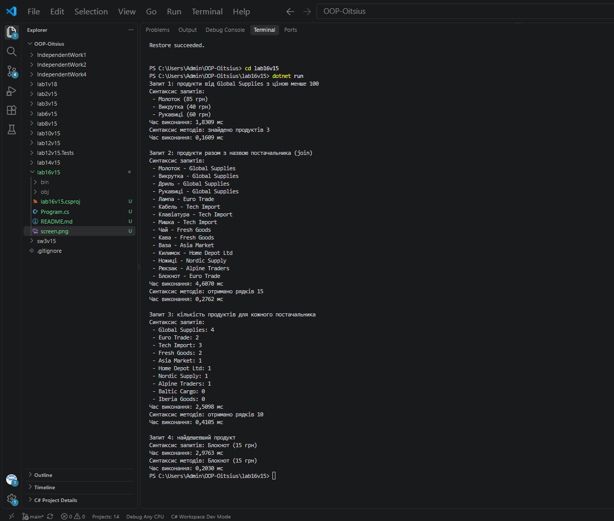

# Лабораторна робота №10

**Тема:** LINQ в дії: фільтри, join, агрегації. Продуктивність.

**Варіант:** 15. Управління товарами на складі

## Мета

Навчитися ефективно використовувати LINQ для фільтрації, об'єднання (join) та агрегації даних, а також аналізувати продуктивність LINQ-запитів.

## Класи сутностей і тестові дані

- **`Supplier`**: `Id`, `Name`, `Country`. У колекції 10 постачальників.
- **`Product`**: `Id`, `Name`, `Price`, `SupplierId`. У колекції 15 продуктів, пов'язаних з постачальниками через `SupplierId`.

## Запити варіанту

Кожен запит реалізовано у двох синтаксисах: синтаксис запитів (`from ... select`) і синтаксис методів (`Where`, `Join`, `GroupJoin`, `Min`, `First`). Час кожного запиту виміряно через `Stopwatch`.

1. Продукти від постачальника "Global Supplies" з ціною менше 100: `where` / `Where`.
2. Об'єднання продуктів з постачальниками, вивід назви продукту і назви постачальника: `join ... on ... equals` / `Join`.
3. Кількість продуктів для кожного постачальника: `join ... into` / `GroupJoin` і `Count`.
4. Найдешевший продукт: `Min` і `First`.

## Запуск

cd lab16v15

dotnet run

## Результат виконання

## Висновок про продуктивність

Колекції невеликі (10 постачальників і 15 продуктів), тому всі часи малі: від соток до кількох мілісекунд. Час міряли разом з `ToList()`, бо через відкладене виконання запит без нього лише описується і не виконується.

У нашому запуску найдовше виконувався запит 2 (`join`) у синтаксисі запитів: 4,6070 мс, далі запит 4 (2,9763 мс) і запит 3 (2,5098 мс). У всіх чотирьох запитах синтаксис запитів показав більший час, ніж синтаксис методів (наприклад, 4,6070 мс проти 0,2762 мс для `join`). Але причина не в самому синтаксисі: синтаксис запитів компілюється в синтаксис методів, тому це ті самі операції. Різниця виникла через порядок вимірювання: синтаксис запитів завжди виконувався першим, а перший виклик кожної операції LINQ (`Where`, `Join`, `GroupJoin`, `Min`, `First`) повільніший, бо .NET вперше готує код до виконання. Синтаксис методів користувався вже підготовленим кодом, тому був швидшим.

Якщо порівнювати лише повторні виклики (синтаксис методів), то найповільнішим був запит 3 з `GroupJoin` (0,4105 мс), далі `Join` у запиті 2 (0,2762 мс), потім запит 4 з `Min` і `First` (0,2030 мс), а найшвидшою була проста фільтрація `Where` у запиті 1 (0,1609 мс). Тобто операції з об'єднанням двох колекцій дорожчі за просту фільтрацію, бо порівнюють ключі обох колекцій.

## Контрольні питання

**1. Поясніть різницю між синтаксисом запитів та синтаксисом методів у LINQ. Коли який краще використовувати?**
Синтаксис запитів схожий на SQL і починається з ключового слова `from`. Синтаксис методів використовує методи `Where`, `OrderBy`, `Select` з лямбда-виразами. Синтаксис запитів компілюється в синтаксис методів. Запити зручні для читання, особливо з `join`, а синтаксис методів зазвичай гнучкіший для складних запитів, і деякі операції, наприклад `Min` чи `First`, пишуться саме методами.

**2. Для чого використовуються операції `Join` та `GroupJoin`? У чому їхня відмінність?**
Обидві операції об'єднують дві колекції за збігом ключів. `Join` повертає пари елементів, які збіглися, а елементи без пари в результат не потрапляють. `GroupJoin` для кожного елемента першої колекції збирає групу відповідних елементів другої, навіть якщо група порожня. У нашій роботі `Join` об'єднує продукти з постачальниками, а `GroupJoin` рахує продукти для кожного постачальника, зокрема і тих, що не мають жодного.

**3. Наведіть приклади агрегуючих операцій LINQ та поясніть їхнє призначення.**
Агрегуючі операції виконують обчислення над набором значень і повертають одне значення. Приклади: `Count` рахує кількість елементів, `Sum` додає значення, `Average` рахує середнє, `Min` і `Max` знаходять найменше й найбільше. У нашій роботі `Count` рахує продукти постачальника, а `Min` знаходить найменшу ціну.

**4. Як можна виміряти продуктивність LINQ-запитів? Які фактори впливають на неї?**
Час можна виміряти класом `Stopwatch`: запустити таймер, виконати запит і зупинити. Через відкладене виконання в замір треба включити виклик, який виконує запит, наприклад `ToList()`. На продуктивність впливають кількість даних, складність операції (`Join` і сортування важчі за `Where`), повторний перебір одного запиту, а також перший запуск, коли код ще готується до виконання.