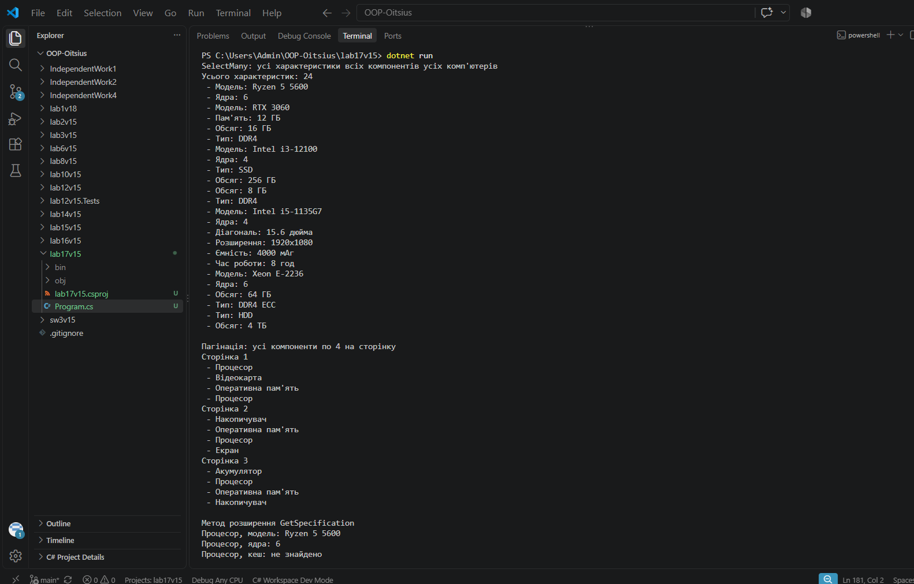

# Лабораторна робота №11

**Тема:** LINQ: `SelectMany`, пагінація й custom extensions.

**Варіант:** 15. Комп'ютери та їхні компоненти з характеристиками

## Мета

Навчитися використовувати оператор SelectMany для роботи з вкладеними колекціями,
реалізовувати пагінацію даних за допомогою LINQ, а також створювати власні методи
розширення для IEnumerable<T> або ключових доменних сутностей.

## Класи сутностей і тестові дані

- **`Computer`**: `Id`, `Name`, список `Components`.
- **`Component`**: `Id`, `Name`, список `Specifications`.
- **`Specification`**: `Id`, `Key`, `Value`.

Тестові дані: 4 комп'ютери, 12 компонентів (по 3 у кожного комп'ютера) і 24 характеристики (по 2 у кожного компонента).

## Що реалізовано

- **`SelectMany`**: усі характеристики всіх компонентів усіх комп'ютерів в одному списку.
- **Пагінація**: усі компоненти виводяться по 4 на сторінку (`Skip` і `Take`), 3 сторінки поспіль.
- **Метод розширення** `GetSpecification(string key)` для `Component`: повертає значення характеристики за ключем, а якщо ключа немає, повертає "не знайдено".

## Запуск

cd lab17v15

dotnet run

## Результат виконання

## Контрольні питання

**1. Для чого використовується оператор `SelectMany`? Наведіть приклад, що демонструє його відмінність від `Select`.**
`SelectMany` перетворює кожен елемент у колекцію, а потім об'єднує всі ці колекції в одну плоску послідовність. `Select` повернув би колекцію колекцій. Приклад: `computers.Select(c => c.Components)` дає 4 окремі списки, а `computers.SelectMany(c => c.Components)` дає один список із 12 компонентів.

**2. Як реалізувати пагінацію даних за допомогою LINQ? Які методи для цього використовуються?**
За допомогою методів `Skip` і `Take`. `Skip((page - 1) * pageSize)` пропускає елементи попередніх сторінок, а `Take(pageSize)` бере елементи потрібної сторінки. У нашій роботі розмір сторінки 4.

**3. Поясніть концепцію методів розширення. Як вони інтегруються з LINQ?**
Методи розширення дозволяють додати новий метод до існуючого типу без зміни його коду. Це статичний метод у статичному класі, перший параметр якого позначений словом `this`. Викликається він як звичайний метод об'єкта. Сам LINQ (`Where`, `Select`, `SelectMany`) складається з методів розширення для `IEnumerable<T>`, тому власні методи розширення можна використовувати разом з ними в одному ланцюжку.

**4. Наведіть приклад власного методу розширення для `IEnumerable<T>` та поясніть його призначення.**
Наприклад, `Paginate(this IEnumerable<T> source, int page, int size)`, який повертає елементи однієї сторінки: `source.Skip((page - 1) * size).Take(size)`. Він інкапсулює пагінацію, і її можна викликати для будь-якої колекції. У нашій роботі метод розширення `GetSpecification` написаний для `Component` і повертає значення характеристики за ключем.