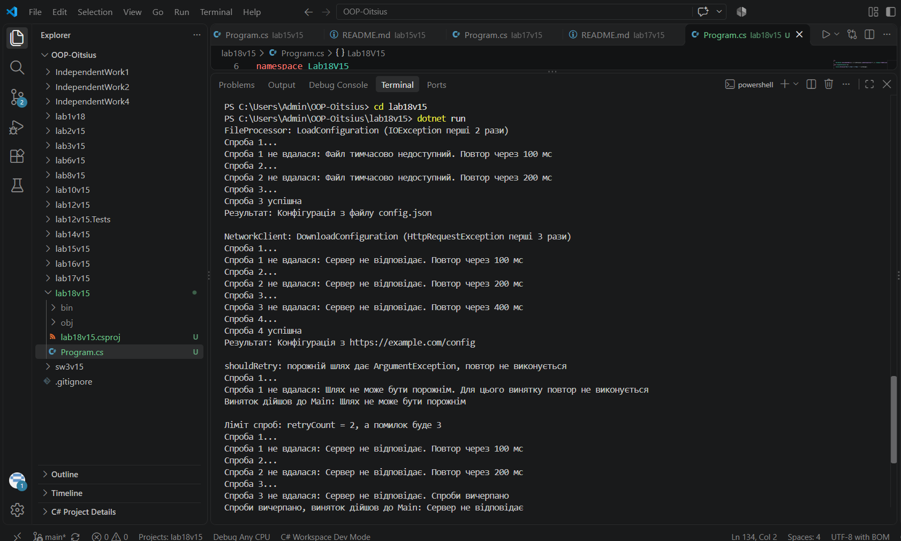

# Лабораторна робота №12

**Тема:** Обробка IO/мережевих помилок та патерн Retry.

**Варіант:** 15. Завантаження файлу конфігурації

## Мета

Навчитися обробляти типові помилки вводу/виводу та мережеві помилки за допомогою
блоків try-catch-finally, а також реалізувати патерн Retry для підвищення відмовостійкості
застосунків.

## Що реалізовано

- **`FileProcessor`**: метод `string LoadConfiguration(string path)`. Імітує `IOException` перші 2 рази, потім повертає результат. Для порожнього шляху кидає `ArgumentException`.
- **`NetworkClient`**: метод `string DownloadConfiguration(string url)`. Імітує `HttpRequestException` перші 3 рази, потім повертає результат.
- **`RetryHelper`**: узагальнений метод `ExecuteWithRetry<T>(Func<T> operation, int retryCount, TimeSpan initialDelay, Func<Exception, bool>? shouldRetry)` з експоненційною затримкою та логуванням кожної спроби й причини невдачі.
- **`shouldRetry`**: повторює спробу для `IOException` та `HttpRequestException`, інші винятки передає далі без повторів.
- У `Main` показано чотири сценарії: перехід від невдачі до успіху для `FileProcessor`, те саме для `NetworkClient`, вибіркову обробку через `shouldRetry` (`ArgumentException` не повторюється) і вичерпання ліміту спроб.

## Запуск

cd lab18v15

dotnet run

## Результат виконання

## Висновок

Експоненційна затримка означає, що пауза перед кожною наступною спробою вдвічі більша за попередню. У нашій реалізації вона дорівнює `initialDelay * 2^номер_спроби` (номер починається з 0), тобто при 100 мс це 100, 200 і 400 мс. Це дає тимчасовій помилці час зникнути і не перевантажує файл чи сервер частими повторами.

## Контрольні питання

**1. Які типи винятків найчастіше виникають при роботі з файлами та мережею?**
З файлами: `FileNotFoundException`, `DirectoryNotFoundException`, `IOException`. З мережею: `HttpRequestException`, `SocketException`.

**2. Поясніть принцип роботи патерну Retry. Коли його доцільно використовувати?**
Retry повторює операцію після невдачі, доки вона не вдасться або не закінчаться дозволені спроби. Його доцільно використовувати для тимчасових помилок: втрата зв'язку, недоступний сервер, зайнятий файл. Для постійних помилок (неправильний шлях, невалідні дані) повтор не допоможе.

**3. Як реалізувати експоненційну затримку між повторними спробами?**
Затримку множать на 2 в степені номера спроби: `initialDelay * 2^attempt`. У коді це `initialDelay.TotalMilliseconds * Math.Pow(2, attempt)`, а очікування виконується через `Thread.Sleep`.

**4. Для чого потрібен делегат `shouldRetry` у допоміжному класі `RetryHelper`?**
Він визначає, для яких винятків потрібно повторювати спробу. У нашій роботі повтор виконується для `IOException` та `HttpRequestException`, а `ArgumentException` одразу передається далі. Завдяки делегату `RetryHelper` універсальний і не прив'язаний до конкретних винятків.