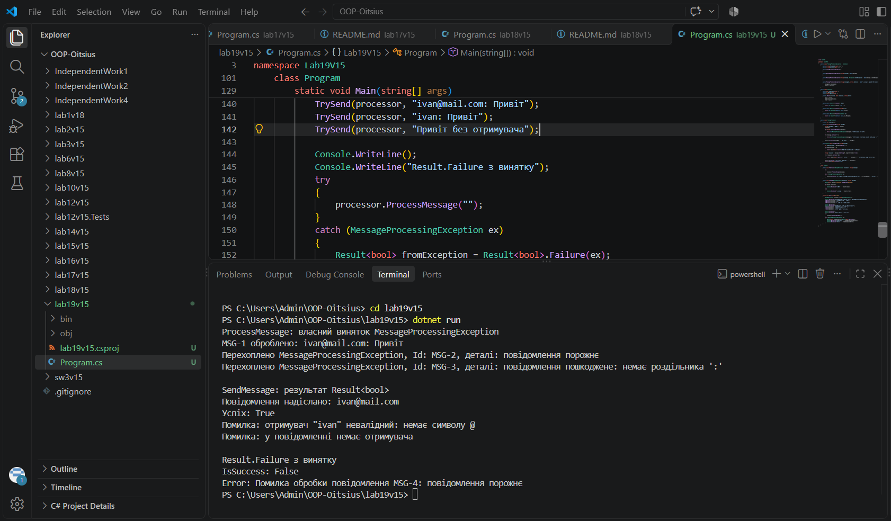

# Лабораторна робота №13

**Тема:** Власні винятки та патерн Result.

**Варіант:** 15. Обробка повідомлень

## Мета

Навчитися створювати власні типи винятків для специфічних помилок, а також реалізовувати патерн Result для більш контрольованої обробки помилок без використання винятків у “нормальних” сценаріях невдачі.

## Що реалізовано

- **`MessageProcessingException`**: власний виняток, успадкований від `Exception`, з властивостями `MessageId` та `Details` і стандартними конструкторами.
- **`Result<T>`**: узагальнений клас з полями `IsSuccess`, `Value`, `Error`, приватним конструктором і фабричними методами `Success(T value)`, `Failure(string error)` та `Failure(Exception ex)`.
- **`MessageProcessor`**: сервіс з двома методами.
  - `void ProcessMessage(string message)` кидає `MessageProcessingException`, якщо повідомлення порожнє або пошкоджене (немає роздільника `:`).
  - `Result<bool> SendMessage(string message)` повертає `Success`, а якщо отримувач невалідний (немає `@`) або його немає, повертає `Failure`.
- Формат повідомлення: `отримувач: текст`, наприклад `ivan@mail.com: Привіт`.
- У `Main` показано обробку виняткового методу через `try/catch` і обробку `Result<bool>` через `IsSuccess` та `Error`.

## Запуск

cd lab19v15

dotnet run

## Результат виконання

## Висновок

Для `ProcessMessage` обрано виняток, бо пошкоджене повідомлення це неочікувана ситуація: обробка не може продовжитися, і помилка має бути помічена та перехоплена. Для `SendMessage` обрано `Result<bool>`, бо невалідний отримувач це звичайний, очікуваний сценарій, який простіше й чистіше обробити через `if (result.IsSuccess)`, не використовуючи винятки для звичайного ходу програми.

## Контрольні питання

**1. Навіщо створювати власні типи винятків? Які переваги це дає?**
Власний виняток описує конкретну помилку застосунку і дозволяє перехопити саме її окремим `catch`. Він може нести додаткові дані, у нашій роботі `MessageId` та `Details`. Код стає зрозумілішим, ніж із загальним `Exception`.

**2. Які стандартні конструктори рекомендується реалізовувати для власних винятків?**
Конструктор без параметрів, конструктор з текстом повідомлення та конструктор з текстом повідомлення і внутрішнім винятком (`innerException`).

**3. Поясніть патерн Result. У яких випадках його використання є більш доцільним, ніж викидання винятків?**
Метод повертає об'єкт `Result<T>`, який містить або успішний результат, або текст помилки, а прапорець `IsSuccess` показує, що саме. Це доцільніше для очікуваних невдач, наприклад невалідні вхідні дані чи відсутній елемент: їх простіше обробити через `if`, а винятки не використовуються для звичайного ходу програми.

**4. Які сценарії краще обробляти через винятки, а які через патерн Result?**
Через винятки краще обробляти неочікувані, виняткові ситуації, які метод не може виправити сам (пошкоджене повідомлення, немає з'єднання). Через `Result` краще обробляти очікувані невдачі, які трапляються в нормальній роботі (валідація даних, елемент не знайдено).