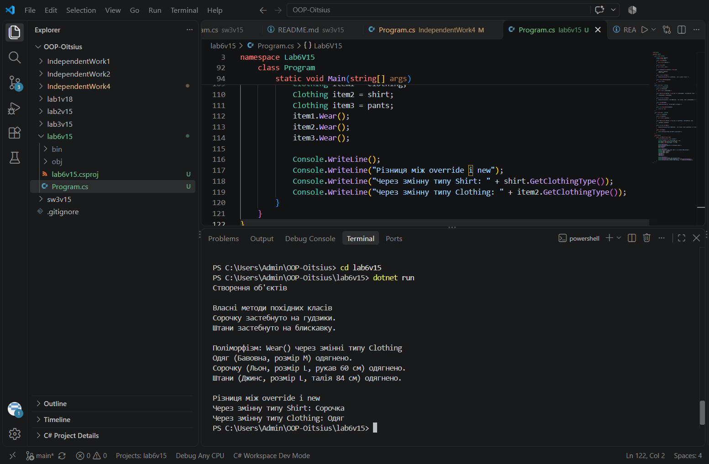

# Лабораторна робота №4

**Тема:** Наслідування.Ключові слова base, override, virtual.Приховування членів(new).

**Варіант:** 15. Ієрархія Clothing → Shirt → Pants

## Мета

Навчитися створювати ієрархії класів, використовувати ключові слова base, virtual, override
для реалізації поліморфізму, а також розуміти відмінності між override та приховуванням членів за допомогою new.

## Що реалізовано

- **Clothing** (базовий клас): приватні поля _material, _size, публічні властивості Material, Size, конструктор, віртуальний метод Wear(), звичайний метод GetClothingType()
- **Shirt** (похідний): поле _sleeveLength, конструктор з викликом base(...), override Wear(), власний метод ButtonUp(), метод new GetClothingType() для демонстрації приховування
- **Pants** (похідний): поле _waistSize, конструктор з викликом base(...), override Wear(), власний метод ZipUp()

## Запуск

cd lab6v15
dotnet run

## Результат виконання

## Контрольні питання

**1. Поясніть принцип наслідування в ООП. Наведіть приклад з реального світу.**
Наслідування дозволяє створити новий клас на основі існуючого: похідний клас отримує поля та методи базового і може додавати власні. Це відношення "є різновидом". Приклад: сорочка і штани — різновиди одягу, обидва мають матеріал і розмір, але кожен має ще й власні характеристики (довжина рукава, обхват талії).

**2. Для чого використовується ключове слово base? Наведіть приклади його застосування.**
Ключове слово base дає доступ до членів базового класу з похідного. Найчастіше його використовують для виклику конструктора базового класу, як у Shirt: `: base(material, size)`, щоб не дублювати ініціалізацію спільних полів. Також через base можна викликати версію методу з базового класу.

**3. У чому полягає різниця між virtual та override? Як вони забезпечують поліморфізм?**
virtual у базовому класі дозволяє похідним класам змінювати поведінку методу. override у похідному класі надає нову реалізацію цього методу. Разом вони забезпечують поліморфізм: при виклику `Wear()` через змінну типу Clothing виконується версія методу того класу, об'єкт якого реально створено (Shirt або Pants), а не тип змінної.

**4. У яких випадках приховування члена через new є виправданим, а в яких небажаним?**
Виправдане, коли в похідному класі потрібен метод з таким самим іменем, а змінити базовий клас не можна, і ми свідомо розуміємо, що виклик залежатиме від типу змінної. Небажане, коли потрібен поліморфізм: з new результат залежить від типу змінної, що легко заплутати, тому в таких випадках краще використовувати virtual і override.

## Стек

- C#
- .NET 10