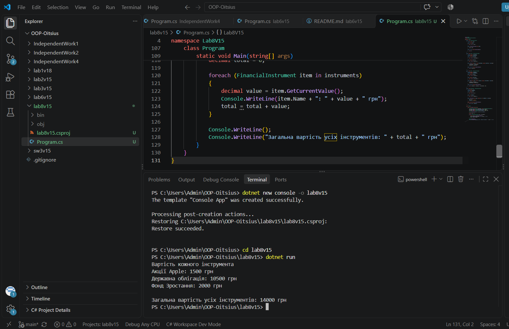

# Лабораторна робота №5

**Тема:** Поліморфізм: динамічне зв'язування та перевизначення методів.

**Варіант:** 15. Поліморфні фінансові інструменти:

## Мета

Навчитися реалізовувати поліморфну поведінку за допомогою віртуальних методів та їх
перевизначення, а також агрегувати результати поліморфних викликів.

## Що реалізовано

- **FinancialInstrument** (базовий клас): властивість Name, конструктор, віртуальний метод GetCurrentValue()
- **Stock**: TickerSymbol, SharePrice, конструктор з base(...), override GetCurrentValue() (повертає ціну акції)
- **Bond**: FaceValue, InterestRate, конструктор з base(...), override GetCurrentValue() (номінал плюс відсотки)
- **MutualFund**: NAV, NumShares, конструктор з base(...), override GetCurrentValue() (NAV помножити на кількість паїв)
- У Main створено список List<FinancialInstrument>, до нього додано акцію, облігацію і фонд, у циклі викликається GetCurrentValue() і підраховується загальна вартість

## Запуск

cd lab8v15
dotnet run

## Результат виконання

## Контрольні питання

**1. Що таке поліморфізм і як він реалізується в C# за допомогою virtual та override?**
Поліморфізм означає "багато форм": об'єкти різних класів реагують на однаковий виклик методу по-різному, залежно від їхнього фактичного типу. У C# це робиться так: у базовому класі метод позначається virtual, а в похідному класі його перевизначають через override. У нашій роботі метод GetCurrentValue() в акції, облігації і фонду рахує вартість по-різному.

**2. Поясніть поняття динамічного зв'язування. Чим воно відрізняється від статичного?**
Динамічне зв'язування — це коли те, який метод буде викликаний, визначається під час виконання програми, за фактичним типом об'єкта. Воно стосується віртуальних методів з override. Статичне зв'язування визначається ще під час компіляції, воно стосується невіртуальних методів і методів, прихованих через new.

**3. Наведіть приклад, як поліморфізм дозволяє писати більш гнучкий та розширюваний код.**
У нашій роботі цикл викликає GetCurrentValue() для кожного елемента списку і не знає, який саме це інструмент. Якщо додати новий клас, наприклад депозит, з власним override, то код циклу змінювати не потрібно. Нові типи додаються без зміни існуючого коду.

**4. Які переваги дає використання колекцій базових типів для роботи з поліморфними об'єктами?**
У одному списку базового типу можна зберігати об'єкти різних похідних класів і працювати з ними однаково, одним циклом. Код стає простішим і загальнішим, а нові типи легко додавати.

## Стек

- C#
- .NET 10