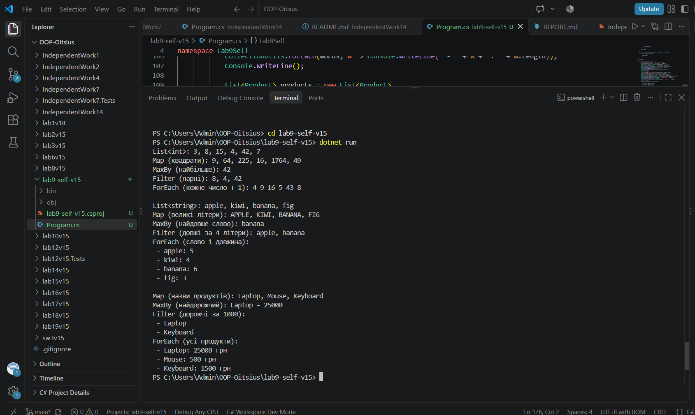

# Самостійна робота №15

**Тема:** Делегати й лямбда-вирази: власні утиліти для колекцій.

## Мета

Поглибити розуміння делегатів та лямбда-виразів через створення власних узагальнених методівутиліт для роботи з колекціями та повторного використання логіки.

## Що реалізовано

Статичний клас `CollectionUtils` з методами `Map<TSource, TResult>`, `MaxBy<T, TKey>`, `Filter<T>` і `ForEach<T>`. У `Main` кожен метод викликано для трьох колекцій (`List<int>`, `List<string>`, `List<Product>`) з різними лямбда-виразами.

## Запуск

cd lab9-self-v15

dotnet run

## Результат виконання

## Звіт

**Чому делегати корисні для створення таких утиліт?**

Делегат дозволяє передати в метод не лише дані, а й дію: що саме зробити з кожним елементом. Тому один метод `Map` чи `Filter` працює з будь-якими типами і з будь-якою поведінкою, і не потрібно писати окремий метод для кожного випадку.

**Як лямбда-вирази спрощують виклик цих методів?**

Лямбда записує потрібну поведінку прямо у виклику, наприклад `p => p.Price > 1000`, без окремого іменованого методу. Код стає коротшим і зрозумілішим, а типи компілятор виводить сам.

**Порівняння з вбудованими LINQ-операторами**

- `Map` відповідає `Select`, `Filter` відповідає `Where`, `MaxBy` відповідає `MaxBy` (є в LINQ починаючи з .NET 6).
- `ForEach` для `IEnumerable<T>` у LINQ немає (є метод `List<T>.ForEach` та звичайний цикл `foreach`).
- Наші методи виконуються одразу і повертають готовий список, а `Select` і `Where` у LINQ виконуються відкладено, лише при переборі результату.
- LINQ має більше можливостей, перевірки на `null` і оптимізації, а наші утиліти простіші й показують принцип роботи.

## Контрольні питання

**1. Чому делегати є зручним механізмом для передавання поведінки в узагальнені методи?**
Делегат зберігає посилання на метод із певною сигнатурою, тому метод можна передати як параметр, і узагальнена утиліта виконує потрібну дію, не знаючи наперед, яку саме.

**2. У чому різниця між `Func<T, TResult>`, `Action<T>` та `Predicate<T>`?**
`Func` приймає параметри і повертає значення (останній тип це тип результату). `Action` приймає параметри, але нічого не повертає (`void`). `Predicate<T>` приймає один параметр і повертає `bool`, тобто перевіряє умову.

**3. Які переваги дає поєднання generic-методів і лямбда-виразів під час роботи з колекціями?**
Один метод працює з будь-яким типом, типи перевіряються під час компіляції, а лямбда коротко описує потрібну дію прямо у виклику.

**4. У яких випадках власні утиліти на кшталт `Map` чи `Filter` корисно реалізувати самостійно, навіть якщо існує LINQ?**
Для навчання, щоб зрозуміти, як працюють делегати та LINQ, коли потрібна особлива поведінка (одразу виконання, логування, власна обробка порожніх колекцій) або коли LINQ недоступний. Також для методів, яких LINQ не має, наприклад `ForEach`.